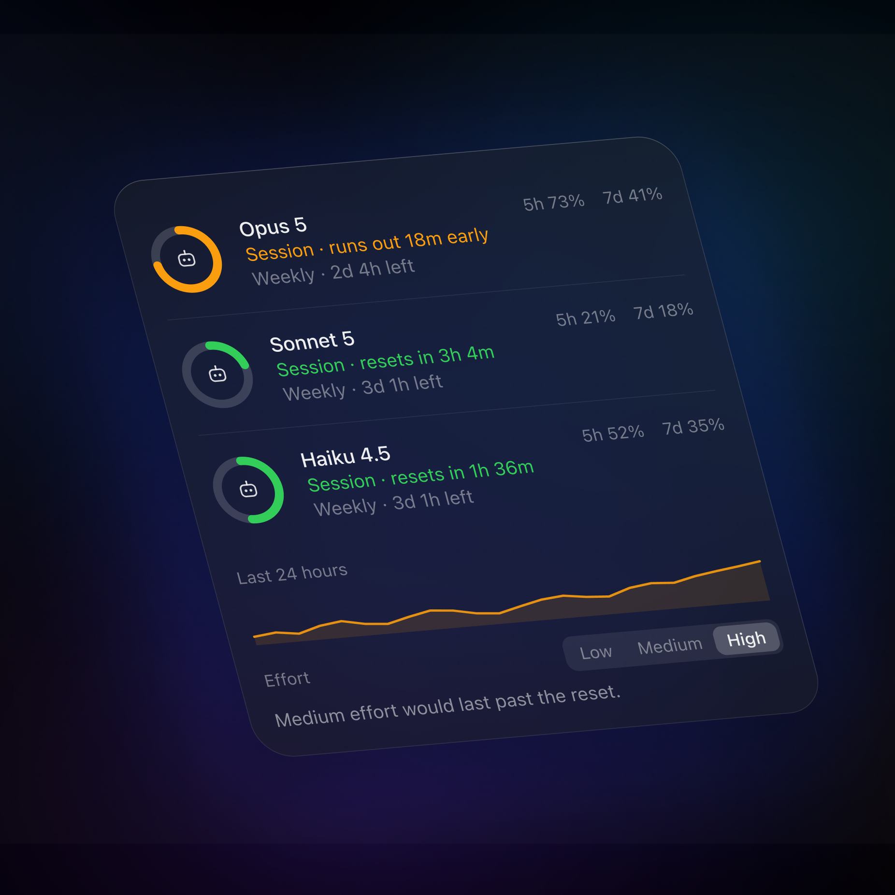
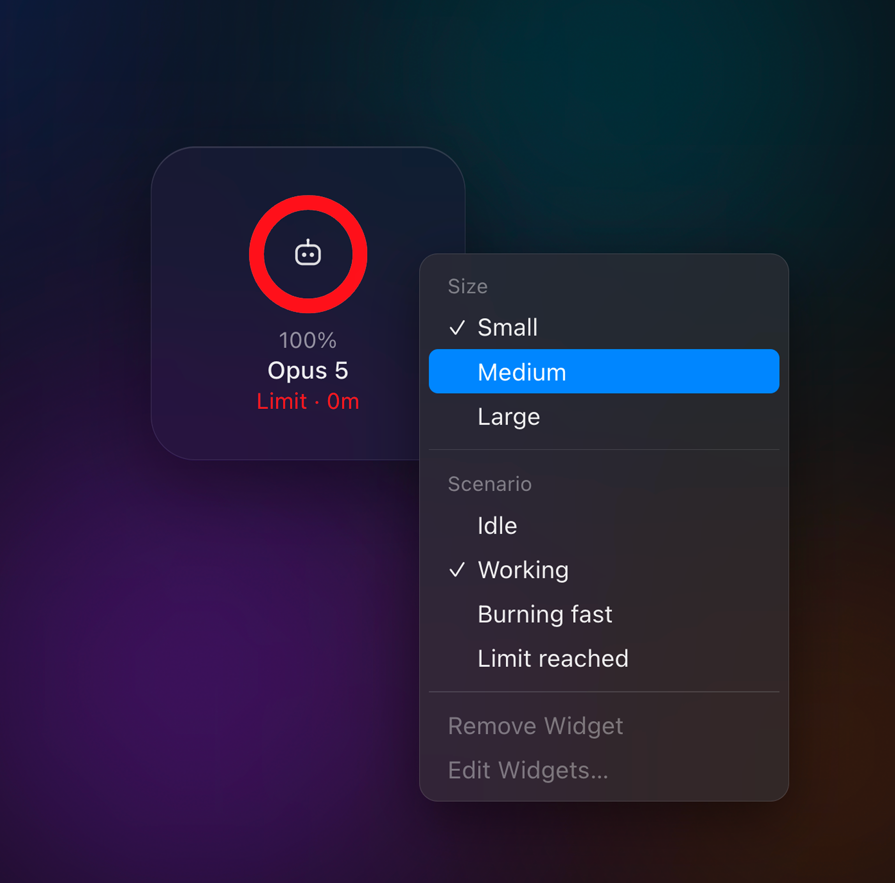

# Agentic UX Lab

Interaction problems in AI and enterprise software, built rather than described.

I'm a product designer working on complex B2B systems — ERP, workflow tooling,
AI-enabled platforms. When a design question is about latency, streaming, autonomy or
trust, a static comp cannot answer it. So I build the answer first, feel where it
breaks, and take it back into Figma once the interaction is settled.

This repo is where those questions get built. One experiment at a time.



*The widget reports the window that runs out first, and says so in time — not percent.*



*A real widget's menu has these items. Their absence is what would give the prototype away.*

## Experiments

| # | Experiment | The question it answers | Demo |
|---|------------|-------------------------|------|
| 01 | Workflow canvas | What does an interface look like when a system is honest about not knowing, and hands the decision back to a person? | [Live →](https://denys-workflow-canvas.vercel.app/experiments/workflow-canvas) |
| 02 | [Usage widget](src/app/experiments/usage-widget) | When you're spending a finite allowance, what number do you actually need to see? | [Live →](https://agentic-ux-lab.vercel.app/experiments/usage-widget) |
| | [Translation trust](src/app/experiments/translation-trust) | When a system rewrites what you say, how do you know what it changed? | Route `/experiments/translation-trust` |
| | Knowledge Atlas | What if the way an AI sorted your notes were something you could see, question and overrule, and the AI then left your correction alone? | [Live →](https://denys-knowledge-atlas.vercel.app) |
| | Keyword Tracker | A keyword rank tracker where the table is the chart — a clickable prototype in React and TypeScript. | [Live →](https://denys-keyword-tracker.vercel.app) |
| | Permission rings | When a scheduling agent can take other people's time, how does a person say how far it may go — without a settings page nobody reads, and without turning every booking into a request? | [Live →](https://permission-rings.vercel.app) |

## Stack

Next.js · TypeScript · Tailwind CSS. Fake data throughout — no backend, no model calls.
Install with npm from `package-lock.json` (`npm ci`).

## Checks

Pull requests and pushes to `main` run on Node 22 in GitHub Actions
(`.github/workflows/ci.yml`):

```bash
npm ci
npm run typecheck
npm run check:registry
npm run check:translation
npm test
npm run lint
npm run build
```

## What this is not

Production code. Each experiment is scoped to one question and deliberately stops at
the edge of it. The list of things I chose *not* to build is part of every experiment
README.

## About

Denys Sergushkin — Principal Product Designer, 14 years in ERP and AI-enabled B2B
software.

[sergushkin.com](https://sergushkin.com) · [LinkedIn](https://linkedin.com/in/sergushkincom) · [Dribbble](https://dribbble.com/sergushkincom)
